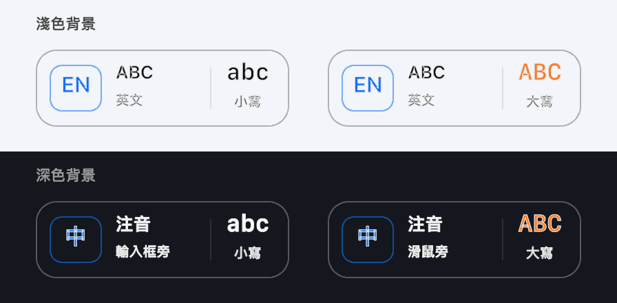

# e04

English · [繁體中文](README.zh-TW.md)

[Website](https://chungchungtin.github.io/CapsStateKeeper/) · [Source preview release](https://github.com/chungchungtin/CapsStateKeeper/releases/tag/v1.2.2-preview.2) · [Report an issue](https://github.com/chungchungtin/CapsStateKeeper/issues)

**Meant to type Chinese, but got a string of English characters instead?**

A Chinese message, an English URL, a switch to another app: when you move between Chinese and English throughout the day, it is easy to leave the wrong input method active. You type, notice the mismatch, delete it, switch modes, and start again. Your train of thought gets interrupted along the way.

e04 (formerly CapsStateKeeper) is a small macOS utility for that everyday friction. While you type, it shows the active input method and `abc / ABC` beside the text cursor, so you can catch a wrong mode sooner and retype less.

The indicator does not take focus, lets mouse clicks pass through, and hides about two seconds after typing stops. The app also shows Caps Lock in the menu bar and repairs a specific Caps Lock mismatch when switching back to ABC.



This is a preview you can build from source. An Apple-notarized installer is not yet available.

## Features

- **Menu-bar status:** an outline icon means Caps Lock is off; a filled icon means it is on.
- **Typing indicator:** shows the input language, input source, and `abc / ABC` near the text cursor. It hides about 2 seconds after typing stops.
- **Adjustable appearance:** separate background and text opacity controls, with a transparent background by default. The indicator does not take focus and lets mouse clicks pass through.
- **Targeted Caps Lock synchronization:** when returning to ABC, restores ON if the keyboard remembers ON while the actual typing flag is OFF. Supports multiple keyboards and avoids changes when conflicting keyboard states cannot be resolved.

The app's menus are currently in Traditional Chinese.

## Build and run

Requires macOS 14 or later and a Swift 6 toolchain. Get the project and build it:

```sh
git clone https://github.com/chungchungtin/CapsStateKeeper.git
cd CapsStateKeeper
./script/build_and_run.sh
```

The app is displayed as **e04**. Its package remains named `CapsStateKeeper.app` to preserve the existing update workflow.

The build opens `dist/CapsStateKeeper.app`. Click its menu-bar icon to access:

| Menu item | Purpose |
| --- | --- |
| 打字時顯示浮標 | Show or hide the typing indicator |
| 浮標設定 | Follow the text cursor; adjust background and text opacity |
| 自動同步 Caps Lock | Enable or disable automatic synchronization; the choice persists across launches and does not affect the indicator |
| 診斷與權限 | Check detection status, synchronize now, restart typing detection, or grant missing permissions |
| 檢查本機更新… | Install a newer package already built on this Mac; appears only when a local update location is configured |
| 關於 e04 | View the app version |

## Permissions and privacy

| Permission | Purpose |
| --- | --- |
| Accessibility | Detect typing, locate the cursor or input field, and prefer letter-case state from read-only keyboard events |
| Input Monitoring | Identify the keyboard used for the input-source switching shortcut, supporting multi-keyboard synchronization |

The menu-bar Caps Lock icon works without these permissions. The floating indicator requires Accessibility. Missing permissions can be addressed under 診斷與權限; granted permissions no longer show a prompt. When the source keyboard cannot be identified and keyboard caches conflict, synchronization does not run.

The app does not store, log, or transmit typed text, make network connections, or capture the screen. Positioning reads geometry only, and the indicator hides during Secure Keyboard Entry. See the [development notes](docs/DEVELOPMENT.md) (Traditional Chinese) for event handling and synchronization boundaries.

## Install and update locally

For regular use and launch at login:

```sh
./script/install.sh
```

The app installs to `~/Applications/CapsStateKeeper.app`. For later updates, build a new package and choose 檢查本機更新… from the menu:

```sh
./script/build_and_run.sh build
```

Alternatively, open `dist/更新 CapsStateKeeper.app`. The updater asks for confirmation, backs up the old version, preserves indicator preferences, and restarts the app. It attempts recovery if the update fails. It uses local packages and does not download updates. Backups are stored in the project's `.app-backups/`; update logs are in `~/Library/Logs/CapsStateKeeper/`.

To remove the installed app and its login item:

```sh
./script/uninstall.sh
```

Current builds use local ad-hoc signing by default. macOS may require permissions to be granted again after a rebuild. A notarized, ready-to-install public release is not yet available.

## Known limitations

- **No indicator while typing:** check 打字時顯示浮標 and the status under 診斷與權限. If permissions are granted but typing is not detected, try 重新啟動打字偵測.
- **Permissions stop working after an update:** quit the app, re-add the installed app under Privacy & Security in System Settings, enable it, and relaunch.
- **輸入框旁 or 滑鼠旁 appears:** the current app does not expose an exact cursor location. The indicator falls back to the input field or the mouse position at the last typing event; it does not continuously follow the mouse.
- **Third-party input method modes:** internal language switches may not be detectable if they are not reported to macOS. `abc / ABC` describes English letter case for the keyboard layout, not automatic capitalization performed by a text field.
- **Synchronization scope:** the repair targets ABC with a remembered ON state and an actual OFF typing flag. It is not a general fix for every Caps Lock or input-method behavior.

For tests, native previews, and implementation details, see the [development notes](docs/DEVELOPMENT.md).

## Feedback and license

Report issues in [GitHub Issues](https://github.com/chungchungtin/CapsStateKeeper/issues) with your macOS version, input method, app, and steps to reproduce. Please keep private typed content out of reports.

Licensed under the [MIT License](LICENSE).
